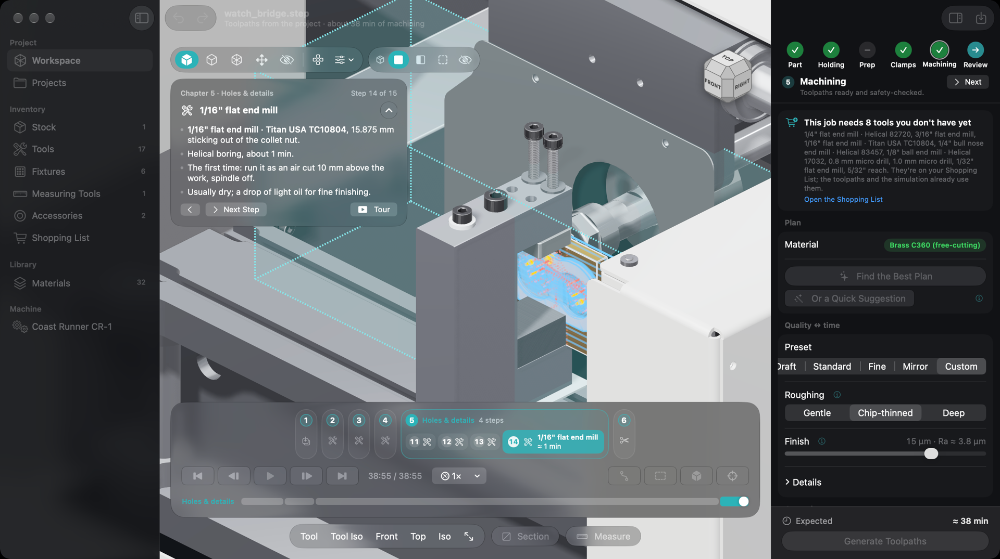

# Coastline

Open-source CAM and guided-setup planning for the **Coast Runner CR-1** desktop mill, as a native
Mac app.

The CR-1 is a capable little machine, but getting a part from CAD onto it takes a lot of manual
work: choosing orientations, fixturing, tools, feeds and toolpaths, then writing a cutcode by hand.
Coastline does that planning for you and hands CRWrite a step-by-step guided job.

> [!WARNING]
> **Alpha, untested on real hardware.** Coastline has never been run on an actual CR-1 or used
> for a real project. Treat it as a concept and a starting point, not a tool to trust with your
> machine. See [Status](#status).



## What it does

- Imports parts from STEP, IGES or Rhino `.3dm` (exact NURBS via OpenCASCADE).
- Plans orientations, one- or two-sided jobs, and holding with the CR-1 clamp kit or flat on the bed.
- Keeps an inventory of your stock, tools, fixtures and measuring tools, and plans only with what you own.
- Generates 2.5D and 3D toolpaths (facing, adaptive roughing, contour, pockets, drilling, helical boring, 3D finishing, engraving).
- Feeds and speeds tuned for the CR-1's 8000 RPM spindle and light frame, across 30+ materials.
- Simulates material removal and checks for collisions with the machine and fixtures.
- Exports a guided `.crproj` job for CRWrite: edge finding, touch-off, tool changes and checkpoints included.

See [docs/FIRST_CUT.md](docs/FIRST_CUT.md) before running anything on a real machine.

## Status

**Alpha: a conceptual app for now.**

- It has only been run against CRWrite's simulated mill, never on a real CR-1.
- It has not been used on a real project. The feeds, speeds, toolpaths, fixture placement and
  collision checks are untested in practice.
- Things will change, break and be wrong. Expect bugs.

The plan is to bring it up on the machine step by step ([docs/FIRST_CUT.md](docs/FIRST_CUT.md))
and update it as it's proven on real cuts. Until then, if you try it: read every program
before you run it, air-cut first, and keep a hand on the stop button. You are responsible for
your machine, your tools and your safety.

There are no prebuilt downloads. Build it from source (below).

## Requirements

- macOS 15 or later on Apple Silicon
- Swift 6 (Xcode or the Command Line Tools)
- [uv](https://docs.astral.sh/uv/) for the Python geometry engine

## Build and run

Set up the engine:

```bash
cd engine && uv sync && native/build.sh
```

Run all tests:

```bash
scripts/selftest.sh
```

Build the app:

```bash
scripts/build-app.sh
```

Start the app:

```bash
Coastline/.build/debug/Coastline
```

## Coast Runner files

The CR-1 machine model, the universal clamp and jig plate models, Coast Runner's Fusion tool
libraries and machine definition, and the feeds and speeds guide in `resources/` and `docs/` are
Coast Runner's own design files. Coast Runner released them under
[CC0 1.0](https://creativecommons.org/publicdomain/zero/1.0/)
([archived licence page](https://web.archive.org/web/20250619071646/https://coastrunner.net/license/)).

## Viewport navigation

| Input | Action |
|---|---|
| Drag | Orbit |
| Two-finger scroll | Pan |
| Pinch | Zoom |
| Option-drag or right-drag | Pan |
| Double-click | Frame everything |

## Layout

| Folder | What |
|---|---|
| `Coastline/` | The SwiftUI app |
| `CoastlineCore/` | Planning, feeds, post-processor, safety checks, guided-job export |
| `Viewport/` | Metal 3D viewport |
| `CRCore/` | `.crproj` reader and writer and the GRBL protocol (a Swift port of CRWrite v2) |
| `engine/` | Python and C++ geometry engine: CAD import, toolpaths, simulation |
| `resources/` | Example projects, samples, fixture models |

## License

GPL-3.0. See [LICENSE](LICENSE) and [docs/THIRD_PARTY.md](docs/THIRD_PARTY.md) for bundled code.

Coastline is an independent project. It is not affiliated with or endorsed by Coast Runner.
"Coast Runner" and "CR-1" are used only to describe the machine this software supports.
